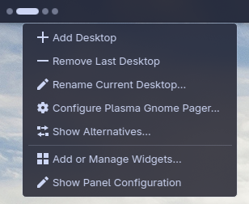
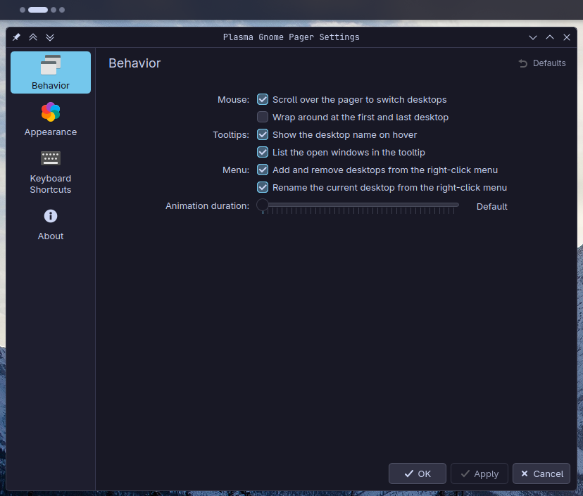
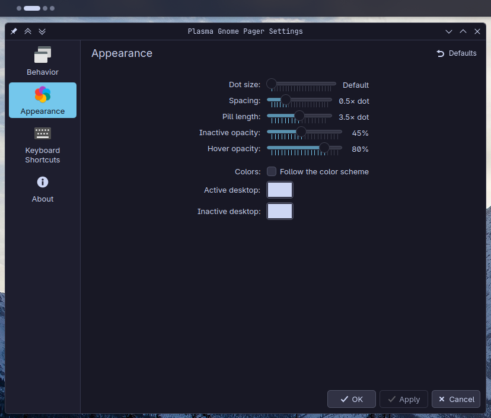

# Plasma Gnome Pager

A GNOME-style virtual desktop switcher for KDE Plasma 6 panels: one dim dot per desktop, with the
current one stretched into a highlighted pill.


## Features

- **Two looks**: the sliding pill, or **Filled & ring**, where every desktop is the same size and
  the current one is a solid dot among hollow rings
- **Click a dot or scroll** over the pager to switch, and optionally click the current desktop for
  Show Desktop, Overview or Grid
- **Tooltips** with each desktop's name and the windows open on it
- **A marker on desktops with open windows**, if you want one, in three styles
- **Add, remove and rename desktops** from the right-click menu, or let **dynamic workspaces** keep
  one empty desktop at the end, as GNOME does
- **Any panel**: horizontal or vertical, with KWin's grid rows mirrored live and dots that shrink
  to fit a thin panel
- **One pager per monitor**, each following its own screen when Plasma 6.7 switches desktops per
  screen
- **A hover highlight** behind the whole pager, as in GNOME's top bar
- **Your colour scheme by default**, or colours of your own
- **Screen reader support**, with each dot a named button
- **Translated into 13 languages**

## Why this exists

Several GNOME-style pagers for Plasma break on point releases, because they import Plasma's private
QML modules or ship a compiled C++ plugin. This one does neither. It's plain QML on public APIs,
reading desktops from `org.kde.taskmanager` and switching them through KWin's DBus interface. It
was built on Plasma 6.6, came through the upgrade to 6.7 untouched, and picked up per-screen
desktops through the public API alone.

## Installation

You need Plasma 6.0 or later.

**From the KDE Store**: right-click the panel or desktop, pick **Add Widgets… → Get New Widgets… →
Download New Plasma Widgets**, and search for "Plasma Gnome Pager". It's also on the
[store page](https://store.kde.org/p/2363190).

**From a release**: download the `.plasmoid` from the
[Releases page](https://github.com/KenanSalar/plasma-gnome-pager/releases) and pick **Install
Widget From Local File…** in the same Get New Widgets menu, or run:

```bash
kpackagetool6 --type Plasma/Applet --install com.github.kenansalar.plasma-gnome-pager-<version>.plasmoid
```

**From source**, with `make` and gettext installed:

```bash
git clone https://github.com/KenanSalar/plasma-gnome-pager.git
cd plasma-gnome-pager
make install    # later, make update to upgrade and make uninstall to remove it
```

Then add **Plasma Gnome Pager** to a panel from **Add Widgets…**. What changed in each version is
in [CHANGELOG.md](CHANGELOG.md).

## Screenshots

The animations are recorded at real panel size, so they look a little soft here.

| Theme highlight (default) | Custom pill colour |
|---|---|
|  |  |

On a vertical panel the row of dots becomes a column, and the pill grows vertically:


| Vertical, theme highlight (default) | Vertical, custom pill colour |
|---|---|
|  |  |

| Right-click menu | Behavior settings | Appearance settings |
|---|---|---|
|  |  |  |

## Configuration

Right-click the pager and pick **Configure…**. The defaults give the GNOME look, and the tables
below follow the dialog's order. The grid rows and the per-screen current desktop aren't settings
here: they follow **System Settings → Virtual Desktops**, so the pager always agrees with KWin.

<details>
<summary><b>Behavior</b>: switching, tooltips and managing desktops</summary>

| Setting | Default | Notes |
|---|---|---|
| **Mouse** | | |
| Scroll over the pager to switch desktops | On | |
| Wrap around at the first and last desktop | Off | |
| Invert the scroll direction | Off | Wheel up moves to the next desktop instead of the previous one. |
| Click current desktop | Nothing | Show Desktop, Overview or Grid, toggled by clicking the highlighted desktop. Clicking any other desktop still switches to it. |
| Trigger it from anywhere on the widget | On | The click action also fires from the space around the dots. |
| **Tooltips** | | |
| Show the desktop name on hover | On | |
| List the open windows in the tooltip | On | |
| **Desktop management** | | |
| Add and remove desktops from the right-click menu | On | Unavailable while desktops are added and removed automatically. |
| Rename the current desktop from the right-click menu | On | |
| Automatically add and remove desktops (GNOME-style) | Off | Keeps exactly one empty desktop at the end: a new one appears when the last fills, and extra empty ones at the end are removed. A desktop with windows in any activity counts as in use. One setting for every pager on every monitor. |
| New desktop name | Desktop | What those desktops are called, followed by their number. Shared the same way. |
| **Animation** | | |
| Animation duration | Default | Default follows Plasma's animation speed, so turning animations off in System Settings turns these off too. |

</details>

<details>
<summary><b>Appearance</b>: style, layout, sizes, hover and colours</summary>

| Setting | Default | Notes |
|---|---|---|
| Pager style | Sliding pill | **Sliding pill**, or **Filled & ring**: no pill, every desktop the same size, the current one filled and the rest hollow rings. The pill settings apply only to Sliding pill. |
| **Layout** | | |
| Show all desktops in a single line | Off | Ignores KWin's grid rows. |
| Match the virtual-desktop grid layout | Off | On a vertical panel, lays the dots out across the panel in KWin's grid order instead of down it. With a single line, that makes one horizontal row. |
| Spacing | 0.50× dot | The gap between neighbouring dots, the pill included, as a multiple of the dot size. |
| **Dots** | | |
| Dot size | Default | Default follows Plasma's icon sizes, so it scales with the display. |
| Inactive opacity | 45% | |
| Hover opacity | 80% | How bright a dot gets under the pointer. |
| **Active pill** | | |
| Pill thickness | Match dots | Set on its own, so a thick pill can sit over small dots or the other way round. |
| Pill length | 4.5× pill | The pill's length as a multiple of its thickness. |
| **Hover background** | | |
| Highlight the whole pager on hover | On | A rounded background fades in behind the pager, as in GNOME's top bar. Turned off, the pager takes only the room its dots need. |
| Background opacity | 12% | |
| Extra length | 1.00× pill | How far the background reaches past each end of the dots. |
| Extra thickness | 1.00× pill | How far it reaches on each side, never past the panel's edge. |
| **Occupied desktops** | | |
| Highlight desktops with open windows | On | With several monitors, each pager counts only the windows on its own screen. |
| Indicator style | Hollow ring | A **Filled** dot, an **Inner dot** on top, or a **Hollow ring** on top. |
| Occupied opacity | 70% | |
| **Colors** | | |
| Follow the color scheme | On | The pill and the occupied marker take the highlight colour, the dots and the hover background the text colour. Turn it off to use the four colours below. |
| Active desktop | `#3daee9` | |
| Inactive desktop | `#eff0f1` | |
| Occupied desktop | `#3daee9` | |
| Hover highlight | `#eff0f1` | |

</details>

The config keys behind these are in [`main.xml`](package/contents/config/main.xml).

## Development

[CONTRIBUTING.md](CONTRIBUTING.md) has the setup, the ground rules and how pull requests are
handled. The Makefile covers the rest:

```bash
make dev                # symlink package/ into ~/.local/share/plasma/plasmoids for live editing
make dev-undev          # remove that symlink
make test               # run the widget standalone, QML errors in the terminal
make restart            # reload plasmashell to pick up changes in the panel
make check              # all headless tests, unit and integration (see tests/README.md)
make check-unit         # only tests/unit
make check-integration  # only tests/integration
make lint               # qmllint over the widget, the settings pages and the tests
make lint-js            # oxlint over the JavaScript modules
make format             # oxfmt the JavaScript, JSON and YAML in place
make format-check       # fail on any file oxfmt would change
make verify             # lint, lint-js, format-check and check: what CI runs
make messages           # extract the strings and merge them into po/*.po
make i18n               # compile po/*.po into the package
make package            # build a .plasmoid into dist/
```

`lint-js`, `format`, `format-check` and `verify` need `npm ci` once first. Nothing from Node ships
in the `.plasmoid`.

## Translations

Besides English, the pager ships in Arabic, Simplified Chinese, French, German, Greek, Italian,
Japanese, Polish, European and Brazilian Portuguese, Russian, Spanish and Turkish, and follows your
Plasma language. [CONTRIBUTING.md](CONTRIBUTING.md#translations) has the steps for adding another.

## License

GPL-3.0-or-later. See [LICENSE](LICENSE).
